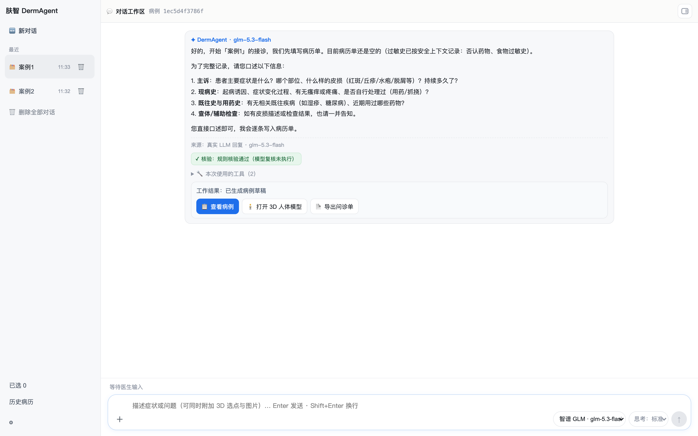
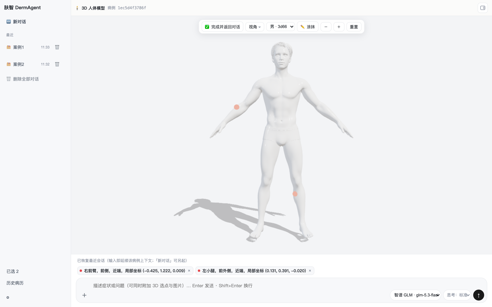
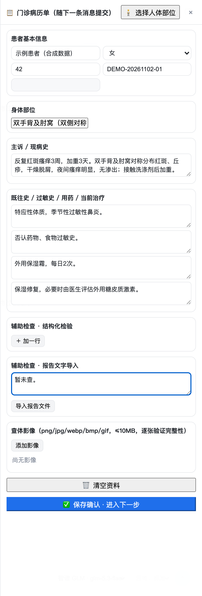
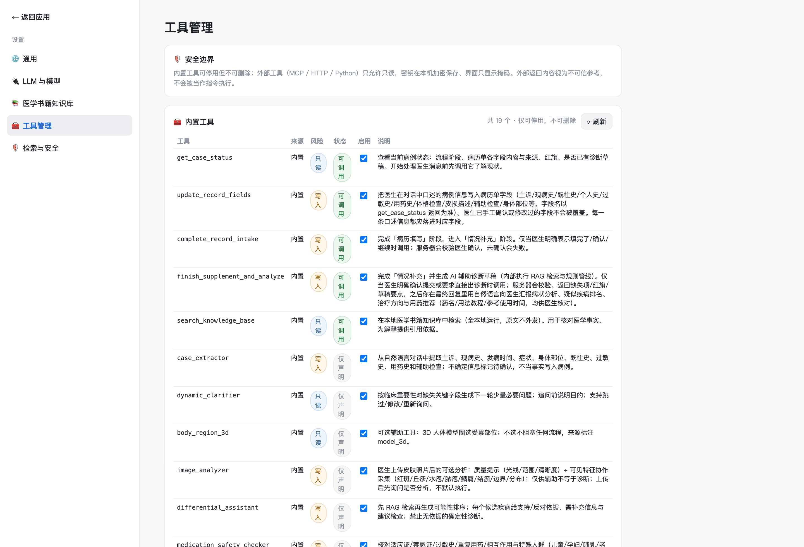

# 肤智 · DermAgent

**面向皮肤科医生的结构化问诊 + 循证辅助智能体（决策支持演示原型）**

`结构化问诊 → 必填校验/红旗筛查 → 本地知识库 RAG（带引用）→ 待审核草稿 → 医生确认/修改/拒绝 → 门诊病历单与报告`

> ⚠️ **本仓库仅供医生侧决策支持演示，不构成诊断、处方或任何诊疗建议。**
> 全部使用**合成/脱敏数据**；系统不自动写入正式病历、不自动提交医嘱或电子处方、不自动执行治疗。
> 鉴别诊断仅供医生核对，最终判断以主诊医生为准。

---

## 三端说明

本产品只有 **三端**，共用同一套前端、同一套规则管线与同一个 `case_id`：

| 端 | 形态 | 启动方式 |
|---|---|---|
| **macOS 桌面** | PySide6 + QtWebEngine 原生窗口 | `python win/frontend/main.py` |
| **Windows 桌面** | PySide6 + QtWebEngine 原生窗口 | `python win\frontend\main.py` |
| **Web** | 浏览器 / PWA，由 FastAPI 托管 | 访问 `http://127.0.0.1:8765/` |

> **本产品没有 Android 端**，仓库不含 APK 或安卓壳。手机浏览器可直接访问 Web 端（局域网内），但不是独立客户端。

---

## 界面速览

> 以下均为本机真实运行截图，病例为合成演示数据。3D 截图使用本地已授权的 GLB 模型，模型文件本身不随仓库分发。

### 对话工作台 · 结构化问诊与 Agent 过程



- 固定阶段推进：问诊 → 校验/红旗 → 检索 → 草稿 → 医生审核；
- Agent 通过工具读取病例状态、写入病历字段，并展示本次工具调用与独立核验结果；
- 每条回复如实标注「真实 LLM / 离线演示 / 失败」，未连接模型时不生成医疗内容。

### 3D 人体定位（可选）



- 点击真实体表三角面，返回「解剖区域 + 表面方位 + 相对位置 + 局部坐标」；
- 每次点击是独立记录，可逐条删除/备注，并随下一条消息带入问诊上下文；
- 缺少授权模型时面板明确不可用，不伪造解剖名。

### 门诊病历单



- 18 字段结构化病历，支持医生手动填写与 3D 部位回填；
- 字段级修改留痕、三态徽章，医生确认后才解锁导出。

### 工具管理与 MCP



- 内置 19 条工具（5 条可执行）可启停；内置工具只停用、不删除；
- 外部 MCP（stdio / SSE / Streamable HTTP）、HTTP 与 Python 工具接入，新工具默认关闭；
- 只读门禁、Fernet 加密密钥、保存即热生效、调用审计。

---

## 目录

- [它解决什么](#它解决什么) · [核心特性](#核心特性) · [架构与技术栈](#架构与技术栈)
- [目录结构](#目录结构) · [部署方法](#部署方法)（macOS / Windows / Web）
- [使用教程](#使用教程) · [工具管理与 MCP](#工具管理与-mcp) · [测试](#测试)
- [常见问题](#常见问题) · [安全与合规](#安全与合规) · [许可与致谢](#许可与致谢)

---

## 它解决什么

皮肤科门诊里，「问全、问准、有据可查」高度依赖医生个人经验。肤智把这件事拆成一条**可审计的固定流程**，并让 AI 只做辅助：

1. **问诊不漏项**：九要素必填校验，缺什么就追问什么（最多两轮），资料不足时不硬编结论。
2. **红旗不放过**：带状疱疹/感染/危险信号等规则筛查，命中即升级为人工审核（`red_flag_escalation.is_blocking`）。
3. **结论有出处**：只从**本机已审核知识库**检索，引用带书名/版本/章节/页码/原文摘录/chunk 哈希；**白名单之外的引用一律剔除并计数**。
4. **医生说了算**：草稿 → 医生「确认 / 修改 / 拒绝」三态（HITL）；未确认则导出按钮物理门禁，不靠提示词自觉。
5. **不装懂**：LLM 未配置或失败 → `workflow_state=llm_unavailable`，**不生成任何医疗内容**，界面横幅如实标注「真实 AI / 离线演示 / 失败」。

---

## 核心特性

- 🩺 **固定阶段图 + 多轮人审**：问诊 → 校验/红旗 → 检索 → 草稿 → 医生审核 → 报告，支持续跑与跨端续办。
- 📚 **本地 RAG**：BM25（中文 2-gram）+ 本地 BGE 向量召回，RRF 融合；缺向量模型时自动降级为纯 BM25 并如实标注，书籍原文不出本机。
- 🧠 **三层记忆**：Redis 短期窗口 / MySQL 患者档案 / Milvus 情景记忆；缺任一依赖时对应层降级，主流程不受影响。
- 🔁 **Agent 运行时**：ReAct + Reflection（规则 + LLM 评审，一次自纠，仍不通过则诚实降级）、回合预算、工具调用容错。
- 🌊 **SSE 流式与断线续传**：过程事件与正文增量输出；`message_id` 保证可恢复。
- 🧰 **工具管理**：内置 19 条工具（5 条可执行）可启停；可接入外部 MCP（stdio / SSE / Streamable HTTP）、HTTP 工具与本地 Python 工具；新工具默认关闭、只读门禁、Fernet 加密密钥、保存即热生效、调用审计。
- 🧍 **3D 人体定位（可选）**：真实人体 GLB + 逐三角面语义表，点击得到「解剖区域 + 表面方位 + 相对位置 + 局部坐标」；模型缺失时明确不可用，不伪造解剖名。
- 📋 **规范门诊病历单**：18 字段、字段级修改留痕、三态徽章、确认后解锁导出。
- 🛰 **跨端续办**：三端读同一份服务端会话状态机，产物与可用动作由服务端派生，前端只渲染不猜测。
- 🔐 **可信边界**：API Key 只在服务端；客户端永不见密钥；照片白名单 + EXIF 清理 + 仅本地脱敏副本；全链路 JSONL 审计。
- 🧯 **断网可演示**：mock 模式为确定性规则管线，零网络、零密钥也能跑完四条演示案例。

---

## 架构与技术栈

```
macOS / Windows 桌面（PySide6 + QtWebEngine）
Web 浏览器 / PWA
        │  同一套前端：原生 JS + Three.js r147（3D 选点）+ PWA 应用壳
        ▼
可信服务层  FastAPI + Uvicorn（默认 :8765）
  ├─ 规则管线  shared/derm_core.py（固定契约，跨端唯一权威实现）
  ├─ Agent 工具循环  agent_loop.py（LLM 决定时机，规则守住底线）
  ├─ 独立核验  reflection.py（规则 + LLM 评审，一次自纠）
  ├─ 本地 RAG  rag.py（BM25 + 引用白名单）· rag_embed.py（BGE 本地向量）
  ├─ 工具运行时  tool_runtime.py / tool_mcp.py（外部 MCP / HTTP / Python 工具）
  ├─ 导航/产物派生  nav.py · artifacts.py（只声明不执行）
  └─ 审计 JSONL · 会话状态机 sessions.json
        │
        └─ 大模型：OpenAI 兼容 /chat/completions + function calling

（可选）平台侧智能体：TypeScript + LangGraph + ACP + MCP（web/backend/agent-langgraph/）
```

| 层 | 技术 |
|---|---|
| 前端 | 原生 JavaScript（零框架）· Three.js r147 UMD · PWA（Service Worker 只缓存应用壳） |
| 后端 | Python 3.12 · FastAPI · Pydantic v2 · Uvicorn · 自研 BM25 · sentence-transformers + torch（可选） |
| 桌面 | PySide6 + QtWebEngine + QWebChannel 双向桥 · Pillow |
| 工具 | 官方 MCP Python SDK（stdio / SSE / Streamable HTTP）· httpx · 子进程 Python 工具 · Fernet |
| 存储（可选） | MySQL 8 · Redis · Milvus 2.5 |
| 智能体（可选） | TypeScript · LangGraph · ACP · MCP · Node ≥ 20 · pnpm |
| 测试 | pytest（服务层 458 例 · 桌面端 39 例）· vitest（TS 侧） |

---

## 目录结构

```
DermAgent/
├── web/
│   ├── frontend/     前端：对话工作台 + 3D 人体 + 门诊病历单（三端共用）
│   └── backend/
│       ├── server/   FastAPI 服务层 + Agent/工具/知识库/记忆模块
│       ├── shared/   规则管线与契约（跨端唯一真源）
│       ├── tests-server/  服务层 pytest
│       └── agent-langgraph/  （可选）TS 智能体模板
├── win/
│   ├── frontend/     PySide6 桌面壳 main.py + 3D 工具链 + 桌面测试
│   └── backend/      客户端接入层 agent_client.py（Server / Mock 双模）
├── deploy/           Milvus docker-compose、MySQL 初始化 SQL
├── scripts/          本地记忆服务启动脚本
├── docs/             产品、API、运行时、知识库、工具管理、部署文档
├── setup-unix-links.sh   macOS/Linux 软链重建
├── setup-windows.bat     Windows junction/hardlink 重建
└── .env.example          环境变量模板（不含任何密钥）
```

> 软链清单、单一真源约定与换机清单见 [`docs/仓库结构与换机部署.md`](docs/仓库结构与换机部署.md)。

---

## 部署方法

### 环境要求

- **Python 3.12**（3.10+ 理论可用，实测 3.12）
- macOS 桌面需要可用的图形会话；Windows 桌面需要 x64 版 Python 与 PySide6 wheel
- 可选：Node ≥ 20 + pnpm（仅 TS 智能体）、Docker（Milvus）、MySQL 8、Redis
- 可选：OpenAI 兼容大模型端点；**不配也能完整演示**
- **不需要** Android SDK/JDK（本产品无 Android 端）

### 通用准备

```bash
git clone https://github.com/Asuka108/DermAgent.git
cd DermAgent
```

仓库内有 10 条兼容软链。macOS/Linux 克隆通常保留软链；Windows 或不支持软链的文件系统需要重建：

```bash
bash setup-unix-links.sh     # macOS / Linux
setup-windows.bat            # Windows（junction + hardlink，无需管理员）
```

然后复制环境变量模板并填写（**不要把 `.env` 提交到仓库**）：

```bash
cp .env.example .env         # Windows: copy .env.example .env
```

**安装依赖的两种口径**：

```bash
# 最小闭环：Web/对话/工具管理；向量与记忆层自动降级
pip install fastapi uvicorn pydantic certifi httpx mcp cryptography

# 完整安装：含本地向量（torch，体积较大）与 MySQL/Redis/Milvus 客户端
pip install -r web/backend/requirements.txt
```

---

### ① macOS 桌面（推荐主链路）

```bash
python3.12 -m venv .venv
source .venv/bin/activate
pip install -r web/backend/requirements.txt -r win/frontend/requirements.txt
cp .env.example .env
python win/frontend/main.py
```

- 桌面端默认 **server 模式**：用当前解释器自动拉起 `win/server/app.py`，并等待 `/api/health` 就绪。
- **同一个 venv 必须同时装桌面端与服务端依赖**；只装 PySide6 时 mock 模式可用，但 server 模式会报 `deps_missing`。
- 可选：在设置里切换到 **mock 模式**，完全离线演示。
- 打包（macOS 本机）：`pyinstaller --name DermAgent --windowed --add-data "web:web" win/frontend/main.py`。

### ② Windows 桌面

```bat
setup-windows.bat
py -3.12 -m venv .venv
.venv\Scripts\activate
pip install -r web\backend\requirements.txt -r win\frontend\requirements.txt
copy .env.example .env
python win\frontend\main.py
```

- 若 `git clone` 时未启用符号链接，`setup-windows.bat` 会把占位文件移走并创建 junction/hardlink；跑完检查脚本末尾的 `OK/FAIL` 行。
- `mklink /H` 要求源与目标在同一磁盘卷；跨盘时请把仓库放在同一分区。
- 打包须在 Windows 本机执行：`pyinstaller --name DermAgent --windowed --add-data "web;web" win\frontend\main.py`（不支持交叉打包）。

### ③ Web

```bash
python3.12 -m venv .venv
source .venv/bin/activate            # Windows: .venv\Scripts\activate
pip install -r web/backend/requirements.txt
cp .env.example .env

cd web/backend/server
PORT=8765 python app.py              # Windows: set PORT=8765 && python app.py
```

浏览器打开 **<http://127.0.0.1:8765/>**。自检：

```bash
curl -s http://127.0.0.1:8765/api/health
```

说明：

- 静态前端由 FastAPI 托管，依赖软链 `web/backend/client/web → ../../frontend`；软链缺失会 404，先跑链接脚本。
- 服务默认监听 `0.0.0.0`。**公网部署必须**加反向代理（HTTPS）、访问控制与防火墙，不要直接暴露 8765。
- 换端口：`PORT=9000 python app.py`，桌面端设置里的服务地址同步修改。
- 局域网手机访问：`http://<电脑IP>:8765/`（浏览器访问，不是 Android 客户端）。

### 3D 资产（可选）

仓库**不包含** 3D 人体模型（授权未登记的模型不公开分发）。需要 3D 定位时，自备已授权模型放到：

```
web/frontend/vendor/models/Custom3d66.glb
web/frontend/vendor/models/Female3d66.glb
```

缺失时 3D 面板不可用（代码会回落程序化人台或明确提示），其余问诊/审核/导出功能不受影响。使用自备模型前请自行确认授权与合规责任。

### 可选外部服务

| 服务 | 作用 | 未配置时 |
|---|---|---|
| LLM（OpenAI 兼容） | 问诊理解、草稿生成、Reflection 评审 | `llm_unavailable`，规则稿/离线演示，不生成医疗内容 |
| MySQL | 患者档案与版本化事实 | 档案层降级；身份字段仍只存本地 |
| Redis | 短期对话窗口（最近 20 轮） | 上下文窗口降级 |
| Milvus | 情景记忆 + 知识库向量集合 | 向量检索降级，可走 BM25 |
| MinerU | PDF/DOCX/EPUB 解析 | 解析 `failed(mineru_unavailable)`，不伪造入库 |
| BGE 向量 / 重排 | 语义召回与重排 | 纯 BM25，界面如实标注 |

- Milvus：`cd deploy/milvus && docker compose up -d`
- MySQL：`mysql < deploy/mysql/001_schema.sql`（服务端也会幂等建表）
- Redis / MySQL / Milvus 本地一键启动：`bash scripts/memory-dev-up.sh`（macOS/Linux）
- 环境变量键名与默认值见 [`.env.example`](.env.example)；根目录 `.env` 是唯一凭据文件（0600），服务端通过 `server/data/local.env` 软链读取。

---

## 使用教程

### 首次配置

界面右下 **⚙ 设置**：

| 分区 | 用途 |
|---|---|
| **LLM 连接** | Base URL + API Key + 模型名，可存多条连接；Key 只落本机 `server/data/llm_config.json`（0600），接口与客户端都不返回 Key 本体 |
| **知识库** | 组件健康、书籍与索引进度、检索测试；PDF/DOCX/EPUB 未装 MinerU 时如实失败 |
| **向量模型** | 可选安装 BGE；未安装时检索降级为纯 BM25 |
| **工具** | 内置工具启停、外部 MCP 服务器、HTTP/Python 工具导入、试调用与调用审计 |

### 跑一次完整问诊（约 2 分钟）

1. 左栏点 **🆕 新对话**。
2. 输入 **`案例1`**（或直接描述症状，如「右手背红斑瘙痒 10 天，外用激素无效」）。
3. 智能体给出结构化问诊草稿与缺失项；缺必填会追问（最多两轮）。
4. 需要精确部位时点 **🧍 选择人体部位** → 3D 工作区点击皮肤区域 → 完成返回（需自备模型）。
5. 点右上 **📋 病历单**，核对/编辑字段，保存确认。
6. 服务端检索知识库并产出**待审核草稿**（含鉴别、依据、检查建议、引用详情与红旗提示）。
7. 医生三态：`确认` → 正式报告与导出解锁；`修改：<意见>` → 修订再审；`拒绝：<理由>` → 不生成报告并留痕。

### 四条合成演示案例

| 输入 | 场景 | 结果 |
|---|---|---|
| `案例1` | 资料齐全 | 草稿 → 确认 → 报告 |
| `案例2` | 带状疱疹红旗 | 升级人工审核 → 修改再审 → 报告 |
| `案例3` | 资料不足 | 追问缺失项 → 补充 → 草稿 → 可拒绝 |
| `案例4` | 知识库未覆盖 | 不编造鉴别与引用，明确「不足以判断」 |

### 断网演示

桌面端切 **mock 模式**，或让服务端保持未配置 LLM：链路完整可跑，横幅明确标注「离线演示 / 规则稿」，不会伪装成 AI 结果。

---

## 工具管理与 MCP

- 入口：Web 设置抽屉 / 桌面 **⚙ 设置 → 🧰 工具**（内置 / MCP / 导入 / 审计四个子页）。
- **内置工具**：19 条定义、5 条可执行，只可停用不可删除；停用核心工具会提示影响。
- **外部 MCP**：支持 stdio、SSE、Streamable HTTP；保存即热生效，可测试连接。
- **HTTP / Python 工具**：HTTP 仅允许 GET/POST 且要求 HTTPS（localhost 例外），禁止重定向与云元数据地址；Python 工具在独立子进程中运行，超时 + JSON 输入输出。
- **只读策略**：MCP 工具必须声明 `readOnlyHint=true` 且非 destructive；写类工具置灰。
- **密钥**：MCP env/headers 与 HTTP headers 使用 Fernet 加密保存（`server/data/tools/fernet.key`，0600），界面只显示掩码。
- **审计**：只记录工具名、来源、耗时、成败与参数摘要，不记录参数内容与密钥。
- **限制**：Python 工具不是 OS 沙箱；外部 HTTP 工具的查询参数会出网；MCP sampling/elicitation 暂不支持。

详见 [`docs/tools-management.md`](docs/tools-management.md) 与 [`docs/mcp.md`](docs/mcp.md)。

---

## 测试

```bash
# 服务层（契约/状态机/引用白名单/医生在环/工具管理/MCP）
cd web/backend && python -m pytest tests-server -q        # 458 passed

# 桌面端（离线管线契约 + 宿主 + 工具客户端）
cd win/frontend && python -m pytest tests -q              # 39 passed

# 前端语法
node --check web/frontend/main.js

# 3D 真机验证（需要自备模型）
cd win/frontend && python tools/verify_3d.py

# TS 智能体（可选）
cd web/backend/agent-langgraph && pnpm test
```

---

## 常见问题

| 现象 | 原因 / 处理 |
|---|---|
| 换电脑后 `win/frontend/web`、`win/server` 等路径报错 | 软链失效。macOS/Linux 跑 `bash setup-unix-links.sh`，Windows 跑 `setup-windows.bat` |
| 端口 8765 被占用 | `PORT=9000 python app.py`，桌面端设置里同步改服务地址 |
| 桌面端 server 模式起不来 / `deps_missing` | 该 venv 缺服务端依赖：`pip install -r web/backend/requirements.txt` |
| 3D 只显示人台或报「模型加载失败」 | 仓库不含 GLB（授权原因）。自备模型放到 `web/frontend/vendor/models/` |
| 页面用 `file://` 打开时 3D 空白 | 请通过 `http://127.0.0.1:8765/` 访问；前端使用 three.js UMD 以兼容 QtWebEngine |
| 大书导入卡住 | 走 HTTP 直连 `POST /api/kb/books`，逐本导入；QWebChannel 单消息过大可能丢数据 |
| 检索没有语义排序 | 未安装向量模型 → 自动降级纯 BM25，界面如实标注 |
| 引用看起来像编造 | 引用 ID 必须命中知识库白名单，否则剔除并计数；引用带 chunk 哈希与检索时间 |
| macOS 出现 `CERTIFICATE_VERIFY_FAILED` | 安装 `certifi`（已在 requirements 中），服务端已显式使用其证书束 |
| 上传接口返回 `multipart_unavailable` | 未安装 `python-multipart`；前端已优先使用 base64 JSON，不影响工具/书籍导入 |
| 想清空数据重来 | 删除 `web/backend/server/data/`（病例/审计/知识库索引/密钥），首次启动自动重建 |

---

## 安全与合规

- **数据**：仅合成/脱敏数据；禁止录入真实患者信息；皮肤照片仅记录去标识化描述，上传走白名单 + EXIF 清理 + 仅本地副本。
- **权限边界**：不自动写入正式病历、不自动提交医嘱/电子处方、不自动执行治疗；输出为**待签署草稿**，签署与执行由医生在授权系统完成。
- **密钥**：模型 Key 只在服务端环境变量或本机 `server/data/llm_config.json`（0600）；工具密钥使用 Fernet 加密（`server/data/tools/fernet.key`，0600）；接口、日志与审计均不输出明文。
- **身份字段**：姓名/电话/身份证/门诊号只存本机 MySQL 与病例窗口，不进入提示词、向量库、审计或错误信息。
- **可审计**：JSONL 操作审计、字段级修改留痕、`message_id`、产物由服务端派生。
- **契约**：输出遵循固定 JSON 契约（`schema_version 1.1`，全 snake_case），Python 服务层与 TS 智能体侧同构。

---

## 许可与致谢

- **代码**：MIT License，见 [`LICENSE`](LICENSE)。
- **不随仓库分发的资产**：3D 人体模型（授权未登记）、知识库备份与第三方医学文本摘录。用户自备模型须自行确认授权；第三方摘录不得再分发。
- **第三方组件**：three.js r147 + OrbitControls/GLTFLoader（MIT，© Three.js authors）；FastAPI / Starlette / Pydantic / Uvicorn（MIT）；PySide6（LGPL-3.0）；LangGraph / LangChain（MIT）；BGE 检索模型（MIT）；官方 MCP Python SDK（MIT）。
- **医学资料**：仓库内知识库与四条案例均为团队自编合成演示资料，非真实临床指南。

---

## 更新日志

见 [`CHANGELOG.md`](CHANGELOG.md)。

---

<sub>**免责声明**：本软件为工程演示原型，输出内容不构成诊断、处方或诊疗建议，不得用于患者自助问诊或自动处方（含剂量与疗程）。任何真实临床使用须经具备资质的医疗专业人员独立判断，并完成相应的合规、伦理与数据授权审查。</sub>
