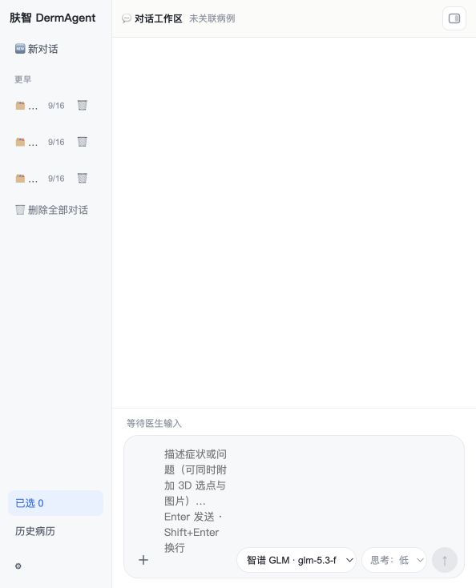
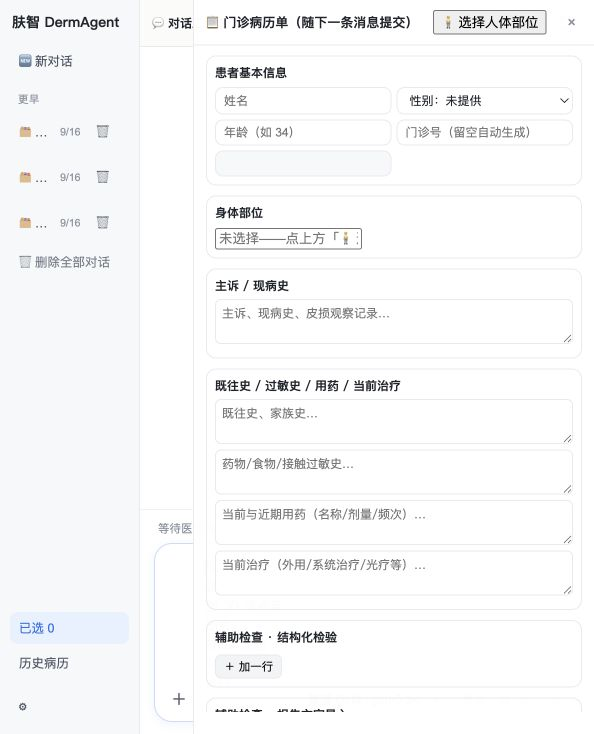
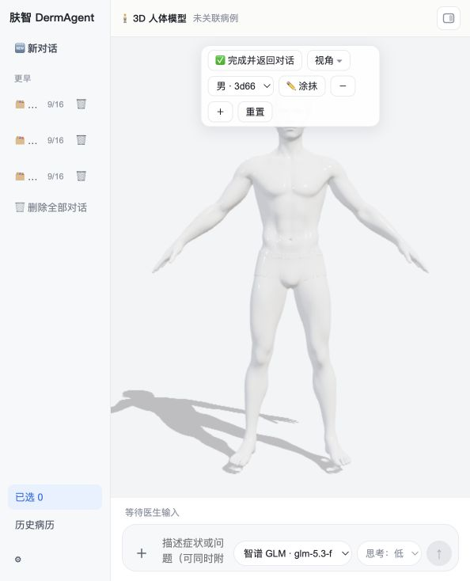

# 肤智 · DermAgent

**面向皮肤科医生的结构化问诊 + 循证辅助智能体（决策支持演示原型）**

`结构化问诊 → 必填校验/红旗筛查 → 本地知识库 RAG（带引用）→ 待审核草稿 → 医生确认/修改/拒绝 → 门诊病历单与报告`

> ⚠️ **本仓库仅供医生侧决策支持演示，不构成诊断、处方或任何诊疗建议。**
> 全部使用**合成/脱敏数据**；系统不自动写入正式病历、不自动提交医嘱或电子处方、不自动执行治疗。
> 鉴别诊断仅供医生核对，最终判断以主诊医生为准。

---

## 界面速览

| 对话工作区（默认主窗口） | 门诊病历单（右侧面板） | 3D 人体定位（可选工具） |
|---|---|---|
|  |  |  |

三端同源：**Web（浏览器/PWA）· Windows 桌面（PySide6）· 安卓（WebView 壳）**，共用同一 `case_id` 跨端续办、同一套界面与规则管线。

---

## 目录

- [它解决什么](#它解决什么) · [核心特性](#核心特性) · [架构与技术栈](#架构与技术栈) · [目录结构](#目录结构)
- [快速开始](#快速开始)（Web / Windows / 安卓 / TS 智能体）
- [使用教程](#使用教程)（首次配置 → 完整问诊演示 → 知识库 → 断网演示）
- [测试与自检](#测试与自检) · [常见问题](#常见问题) · [安全与合规](#安全与合规) · [开源前须处理](#开源前须处理) · [许可与致谢](#许可与致谢)

---

## 它解决什么

皮肤科门诊里，「问全、问准、有据可查」高度依赖医生个人经验。肤智把这件事拆成一条**可审计的固定流程**，并让 AI 只做辅助：

1. **问诊不漏项**：九要素必填校验，缺什么就追问什么（最多两轮），资料不足时不硬编结论。
2. **红旗不放过**：带状疱疹/感染/危险信号等规则筛查，命中即升级为人工审核（`red_flag_escalation.is_blocking`）。
3. **结论有出处**：只从**本机已审核知识库**检索，引用带书名/版本/章节/页码/原文摘录/chunk 哈希；**白名单之外的引用一律剔除并计数**。
4. **医生说了算**：草稿 → 医生「确认 / 修改 / 拒绝」三态（HITL）；未确认则导出按钮物理门禁，不靠提示词自觉。
5. **不装懂**：LLM 未配置或失败 → `workflow_state=llm_unavailable`，**不生成任何医疗内容**，界面横幅如实标注「真实 AI / 离线演示 / 失败」。

## 核心特性

- 🩺 **固定阶段图 + 多轮人审**：问诊 → 校验/红旗 → 检索 → 草稿 → 医生审核 → 报告，`interrupt/resume` 续跑
- 📚 **本地 RAG**：BM25（Okapi k1=1.5/b=0.75，中文 2-gram）+ 本地 BGE 向量召回，RRF(k=60) 融合；**书籍原文不出本机**
- 🧍 **3D 人体定位**：真实人体 GLB（男/女）+ **逐三角面语义表**（129.55 万面离线查表），点击即得「解剖区域+表面方位+相对位置+局部坐标」，语义不足时明确报「缺少可靠语义」而非伪造解剖名
- 📋 **规范门诊病历单**：患者信息/主诉/既往史/用药/过敏/危险信号/辅助检查等 18 字段，字段级修改留痕、三态徽章、确认后解锁导出
- 🛰 **跨端续办**：Web / Windows / 安卓同一 `case_id`；对话优先、结果按需打开（服务端只声明 `artifacts/available_actions`，前端不猜）
- 🔐 **可信边界**：API Key 只在服务端；客户端永不见密钥；照片白名单 + EXIF 清理 + 仅本地脱敏副本；全链路 JSONL 操作审计
- 🧯 **断网可演示**：mock 模式为确定性规则管线，零网络、零密钥也能跑完四条演示案例

## 架构与技术栈

```
医生（浏览器 / PySide6 桌面 / 安卓 WebView）
        │  同一套前端：原生 JS + Three.js r147（3D 选点）+ PWA 应用壳
        ▼
可信服务层  FastAPI + Uvicorn（44 个 REST 端点，默认 :8765）
  ├─ 规则管线  shared/derm_core.py（v1.1 固定契约，跨端唯一权威实现）
  ├─ Agent 工具循环  agent_loop.py（LLM 决定时机，规则守住底线；≤6 步/回合，失败即降级）
  ├─ 本地 RAG  rag.py(BM25+切分+引用白名单) · rag_embed.py(BGE 本地向量)
  ├─ 导航/产物派生  nav.py · artifacts.py（只声明不执行）
  └─ 审计 JSONL · 会话状态机 sessions.json
        │
        └─ 大模型：OpenAI 兼容 /chat/completions + function calling（DeepSeek / 智谱 GLM / 通用端点）

（可选）平台侧智能体：TypeScript + LangGraph StateGraph + ACP + MCP（web/backend/agent-langgraph/）
```

| 层 | 技术 |
|---|---|
| 前端 | 原生 JavaScript（零框架）· Three.js r147 UMD + OrbitControls + GLTFLoader · PWA（Service Worker 只缓存应用壳，API 永不缓存） |
| 后端 | Python 3.10+（实测 3.12）· FastAPI · Pydantic v2 · Uvicorn · 纯标准库 LLM 调用 · 自研 BM25 · sentence-transformers + torch（可选向量通道） |
| 桌面 | PySide6 6.11 + QtWebEngine + QWebChannel 双向桥 · Pillow（EXIF 清理） |
| 安卓 | 零 Gradle 命令行构建（aapt2 + javac + d8 + zipalign + apksigner）+ 原生 WebView 壳 |
| 智能体（可选） | TypeScript 5.9 · `@langchain/langgraph` · `deepagents` · ACP SDK · MCP（`@langchain/mcp-adapters`）· Node ≥ 20 · pnpm 10 |
| 测试 | pytest（服务层 94 例 + 桌面端 22 例）· vitest（TS 侧 50 个测试文件）· QtWebEngine 真机渲染验证 |

## 目录结构

```
DermAgent/
├── web/
│   ├── frontend/     前端：对话工作台 + 3D 人体 + 门诊病历单（浏览器/PWA/安卓/桌面共用）
│   └── backend/      后端：FastAPI 服务层 + shared 规则管线 + 测试 + agent-langgraph（TS 智能体）
├── win/
│   ├── frontend/     桌面壳：main.py（PySide6）+ tools/（3D 语义表生成与真机验证）+ tests/
│   └── backend/      客户端接入层：agent_client.py（Server / Mock 双模）
└── docs/             产品·验收·授权文档 + 仓库结构与换机部署说明
```

> 详细映射表、软链清单与换电脑部署清单 → [`docs/仓库结构与换机部署.md`](docs/仓库结构与换机部署.md)

---

## 快速开始

### 环境要求

- **Python 3.10+**（开发实测 3.12）
- 桌面端额外需要 **PySide6（含 QtWebEngine）**；安卓端需要 JDK + Android SDK 34；TS 智能体需要 **Node ≥ 20 + pnpm 10**
- 大模型端点（可选，OpenAI 兼容即可）；**不配也能完整演示**

### ① Web 端（推荐先跑这个）

```bash
cd DermAgent/web/backend
python3 -m venv .venv && source .venv/bin/activate        # Windows: .venv\Scripts\activate
pip install -r requirements.txt

cd server && python app.py                                 # 默认端口 8765，可 PORT=9000 python app.py
```

浏览器打开 **http://127.0.0.1:8765/** ，自检：

```bash
curl -s http://127.0.0.1:8765/api/health
# {"status":"ok","schema_version":"1.1","llm":"server","knowledge_snapshot":"synthetic-kb@2026-09-04"}
```

### ② Windows / macOS 桌面端

```bash
cd DermAgent/win/frontend
python3 -m venv .venv && source .venv/bin/activate
# ⚠️ 必须连服务端依赖一起装：main.py 用同一个解释器自动拉起 server/app.py
pip install -r requirements.txt -r ../../web/backend/requirements.txt
python main.py
```

- **server 模式（默认）**：自动探测/拉起本机服务层，状态栏提示「✅ 本地服务端已自动启动」
- **mock 模式**：完全离线的确定性规则管线，断网可演示、结果可复现
- 打 Windows 可执行：`pyinstaller --name Fuzhi3D --windowed --add-data "web:web" main.py`（**须在 Windows 上执行**）

### ③ 安卓端

```bash
cd DermAgent/web/frontend/android && bash build_apk.sh     # 产物 dermagent.apk
# 手机与电脑同一局域网，浏览器访问 http://<电脑IP>:8765/ 亦可（无需安装 APK）
```

> `MainActivity.java` 里的默认地址是开发期写死的局域网 IP，换网络后 App 会弹地址框（可改并持久化）。

### ④ 平台侧智能体（可选，TypeScript）

```bash
cd DermAgent/web/backend/agent-langgraph
pnpm install && cp .env.example .env      # 填 OPENAI_API_KEY / OPENAI_BASE_URL（DeepSeek/千问/GLM/Kimi 均可）
pnpm flow "案例1"                          # 本地快检：跑到医生审核 interrupt 后直接输入「确认」续跑
pnpm graph                                 # 导出默认图拓扑
```

---

## 使用教程

### 0）首次配置（一次性，界面右下 ⚙ 设置）

| 分区 | 做什么 |
|---|---|
| **LLM 连接** | 选 DeepSeek / 智谱 GLM / 通用 OpenAI 兼容，填 Base URL + API Key + 模型名，可存多条连接并切换「活动连接」，支持思考等级（低/中/高）。**Key 只落本机服务端 `server/data/llm_config.json`，任何接口与客户端都不返回 Key 本体** |
| **知识库** | 「批量导入」选书（内置解析器支持 `.txt/.md/.html`；PDF/DOCX/EPUB 未接解析器会**如实标记 failed**，不伪造入库）；可设切分方式（按章节/段落/整书）与检索强度（2/3/6 条）；支持重建索引、备份与恢复 |
| **向量模型** | 自选 BGE（small/base/large/M3），**首次允许联网下载固定版本，之后全本地推理**；未安装则自动降级为纯 BM25 并在状态里如实标注 |
| **安全** | 免责声明、数据快照版本、审计说明 |

> 知识库也可以命令行灌：`curl -X POST http://127.0.0.1:8765/api/kb/restore -H 'Content-Type: application/json' -d @备份.json`

### 1）跑一次完整问诊（约 2 分钟）

1. 左栏点 **🆕 新对话**（清场，不删历史）。
2. 在底部输入框输入 **`案例1`** 后回车（或直接用自由文本描述症状，如「右手背红斑瘙痒 10 天，外用激素无效」）。
3. 智能体给出**结构化问诊草稿**与缺失项；缺必填会**追问**（按「字段：值」或直接自由文本补充，最多两轮）。
4. 需要精确部位时点 **🧍 选择人体部位** → 进入 3D 工作区 → 旋转/缩放/切换视角后**点击皮肤区域** → 每次点击生成一条独立记录（含解剖区域、表面方位、相对位置、局部坐标），可备注、可 × 删除 → 点 **✅ 完成并返回对话**。
5. 点右上 **📋 病历单** 打开门诊病历单，核对/编辑字段，点 **✅ 保存确认 · 进入下一步**（医生已确认字段 AI 不得覆盖）。
6. 服务端检索知识库并产出**待审核草稿**：含鉴别诊断（待排）、依据、建议检查、治疗参考、恢复周期、**引用详情卡**（书名/版本/章节/页码/原文摘录/检索时间）与红旗提示。
7. **医生三态**：
   - `确认` → 生成正式报告（流式输出），导出按钮解锁
   - `修改：<意见>` → 按意见修订 → 再审（回到第 7 步）
   - `拒绝：<理由>` → **不生成报告**，病例关闭并留痕
8. 病历单里 **导出**（Markdown，含编号/状态/引用/免责声明与「待签署草稿」签署说明），或 **🕘 查看历史版本** 看每个字段的修改留痕。

### 2）四条合成演示案例

| 输入 | 场景 | 你会看到 |
|---|---|---|
| `案例1` / 湿疹样皮疹 | 资料齐全 | 草稿 → 「确认」→ 正式报告 |
| `案例2` / 带状疱疹 | 红旗升级 | 草稿带 🚩 `severity=needs_review` → 「修改：…」→ 修订再审 → 报告 |
| `案例3` / 资料不足 | 缺项追问 | 追问缺失项 → 「补充：病程5天；…」→ 草稿 → 「拒绝：理由」→ 不出报告 |
| `案例4` / 无答案 | 拒答纪律 | 知识库未覆盖 → **不编造鉴别诊断与引用**，草稿标注「不足以判断」并建议面诊 |

### 3）断网 / 没有 API Key 的演示

直接用 **mock 模式**（桌面端设置里切）或让服务端保持未配置 LLM：链路完整可跑，但界面横幅会明确标注 **「离线演示 / 规则稿」**（`generatedBy: rule-fallback`），绝不会出现伪装成 AI 的医疗建议。检索仍走本机 BM25，书籍原文不出本机。

### 4）跨端续办

手机装 APK（或手机浏览器）访问 `http://<电脑IP>:8765/`，在电脑端「历史病历」里打开同一病例即可续办——三端读同一份会话状态机与契约字段。

---

## 测试与自检

```bash
# 服务层（44 端点 / 契约 / 状态机 / 引用白名单 / 医生在环 / 跨端续办）
cd DermAgent/web/backend && python -m pytest tests-server -q          # 94 passed

# 桌面端（离线管线契约 + 宿主逻辑）
cd DermAgent/win/frontend && python -m pytest tests -q                # 22 passed

# 3D 真机验证（QtWebEngine 实渲染：三角数/拾取/高亮互斥/锚点断言 + 正背面截图）
cd DermAgent/win/frontend && python tools/verify_3d.py

# TS 智能体
cd DermAgent/web/backend/agent-langgraph && pnpm test
```

---

## 常见问题

| 现象 | 原因 / 处理 |
|---|---|
| 换电脑后 `win/frontend/web`、`win/server` 等路径报错 | 软链在 Windows/U 盘失效。跑根目录 `setup-windows.bat`（junction+hardlink，免管理员）或 `setup-unix-links.sh` |
| 端口 8765 被占用 | `PORT=9000 python app.py`，桌面端设置里同步改服务地址 |
| 桌面端 server 模式起不来 | 该 venv 缺服务端依赖：`pip install -r ../../web/backend/requirements.txt`（`main.py` 用 `sys.executable` 拉起服务） |
| 3D 只显示灰色人台 / 报「人体模型加载失败」 | GLB 未随包或被拦截；代码会自动回落程序化人台，检查 `web/frontend/vendor/models/*.glb` 是否存在 |
| 页面在本地 `file://` 打开时 3D 空白 | QtWebEngine/Chromium 阻止 `file://` 下的 ES Module，因此前端刻意使用 three.js **UMD** 构建；请用 `http://127.0.0.1:8765/` 访问 |
| 大书导入卡住或无反应 | 走 HTTP 直连（`POST /api/kb/books`）而非桥消息（QWebChannel 单消息 >~1MB 会静默丢数据）；逐本顺序导入并显示进度 |
| 检索结果没有语义排序 | 未安装本地向量模型 → 自动降级纯 BM25，界面如实标注（不伪造 hybrid） |
| 引用看起来像编造 | 不可能：引用 ID 必须命中知识库白名单，否则剔除并在草稿里计数；`citation` 带 chunk 哈希与检索时间可回溯 |
| 想清空数据重来 | 删 `web/backend/server/data/`（运行时目录：病例/审计/知识库索引/向量权重），首次启动会自动重建 |

---

## 安全与合规

- **数据**：仅合成/脱敏数据（内置知识库与四条案例均为团队自编合成资料，快照 `synthetic-kb@2026-09-04`）；禁止录入任何真实患者信息；皮肤照片仅记录去标识化描述，上传走白名单 + EXIF 清理 + 仅本地副本。
- **权限边界**：不自动写入正式病历、不自动提交医嘱/电子处方、不自动执行治疗；输出为**待签署草稿**，最终签署与执行必须在授权医疗系统由医生完成。
- **密钥**：模型 Key 只在服务端环境变量或本机 `server/data/llm_config.json`（0600 权限、脱敏读取），任何接口与客户端都不返回 Key 本体，日志对 Key/端点脱敏。
- **可审计**：操作审计 JSONL；字段级修改留痕与历史版本；每条回复携带 `message_id`，产物与动作由服务端派生（`artifacts` / `available_actions`），前端只渲染不猜测。
- **契约**：输出遵循固定 JSON 契约 `schema_version 1.1`（`workflow_state` / `blocking_reason` / `follow_up_questions` / `red_flag_escalation.is_blocking` / `safety_policy_version` / `review_status`，全 snake_case），Python 服务层与 TS 智能体侧同构。

## ⚠️ 开源前须处理

1. **3D 人体模型授权未确权**：`web/frontend/vendor/models/*.glb` 来自第三方模型站（材质名 `Mat3d66_853441_*`），**尚未在 [`docs/data-license-register.md`](docs/data-license-register.md) 登记授权来源**。公开再分发前请取得授权并补台账，或先从仓库移除模型（代码会自动回落程序化人台，不影响运行）。
2. **知识库备份含原文摘录**：根目录 `kb-backup-2026-10-23.json`（换机用）含第三方医学文献片段，**不要提交到公开仓库**。
3. **写死的局域网地址**：`web/frontend/android/java/.../MainActivity.java` 的 `DEFAULT_URL`。
4. 单文件 >100MB 会被 GitHub 拒收；>50MB 会收到警告（当前最大文件 89.6MB）。

## 许可与致谢

- 代码：本仓库源码采用 **MIT License**（见 `LICENSE`；如团队需要专利授权条款可改 Apache-2.0）。
- 第三方组件：three.js r147 + OrbitControls/GLTFLoader（**MIT**，© Three.js authors）；FastAPI / Starlette / Pydantic / Uvicorn（MIT）；PySide6（LGPL-3.0）；LangGraph / LangChain（MIT）；BGE 检索模型（MIT）；旧版曾使用的 Cesium Man（**CC BY 4.0**，© Analytical Graphics, Inc.）与 Michelle（three.js 示例资产）已在 v64-P6 移除。
- 医学资料：全部为团队自编**合成演示资料**，非真实临床指南；审核签字流程见 `docs/data-license-register.md`。
- 文档：产品设计与验收卡见 `docs/`（`derm-product-design.md`、`cross-platform-acceptance.md`、`doctor_pilot.md`）。

---

<sub>**免责声明**：本软件为工程演示原型，输出内容不构成诊断、处方或诊疗建议，不得用于患者自助问诊或自动处方（含剂量与疗程）。任何真实临床使用须经具备资质的医疗专业人员独立判断，并完成相应的合规、伦理与数据授权审查。</sub>
